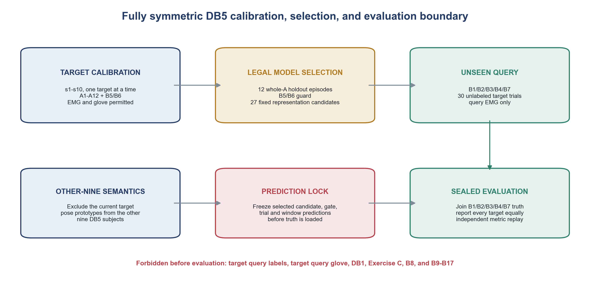
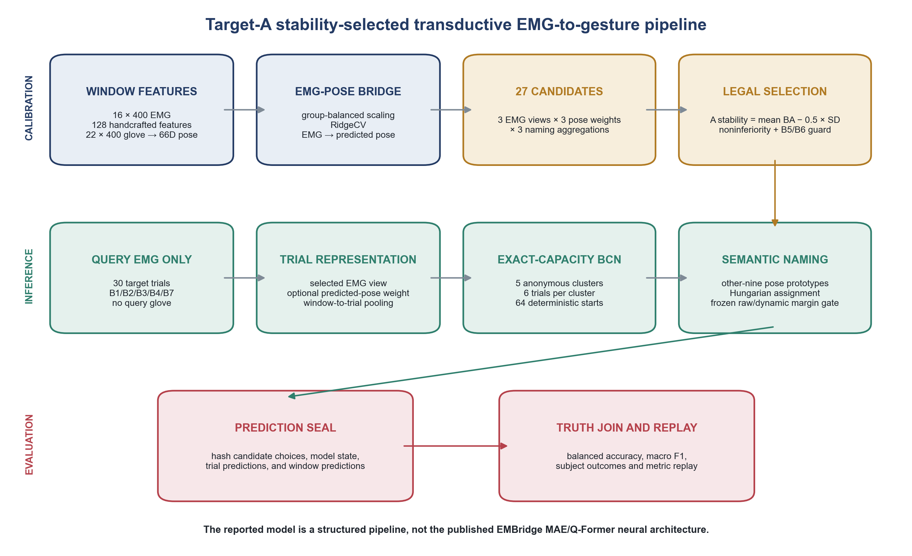
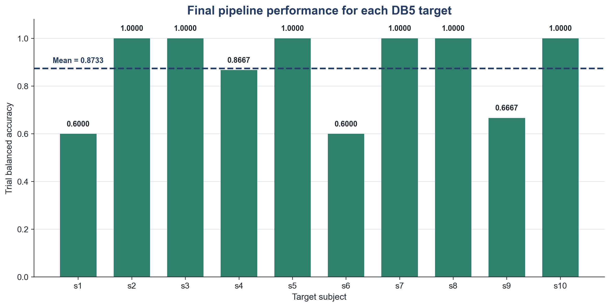
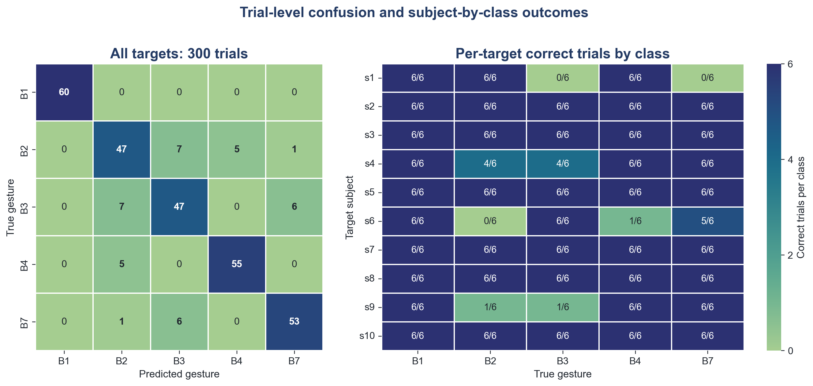

# Pose-Assisted Unseen-Gesture Recognition on NinaPro DB5

This repository contains a research pipeline for recognizing **unseen Exercise-B
hand gestures from target-subject EMG**. The target subject is calibrated with the
12 basic Exercise-A movements plus Exercise-B movements B5 and B6. The evaluated
classes B1, B2, B3, B4, and B7 have no labeled target-subject EMG examples in the
calibration set.

The implementation is a structured pipeline based on handcrafted EMG features,
RidgeCV pose prediction, exact-capacity balanced clustering, cross-subject pose
prototypes, and one-to-one semantic assignment. It is **not** an implementation of
the EMBridge MAE/Q-Former neural architecture.

> **Result scope:** the values below are replay-verified retrospective internal
> development results on the same ten-subject DB5 cohort that informed method
> development. They are not independent external-validation estimates.

## Study at a glance

| Item | Setting |
|---|---|
| Dataset | NinaPro DB5 only |
| Participants | `s1`-`s10`, each used once as the target |
| Target calibration | `A1`-`A12` and `B5`/`B6`, EMG and glove permitted |
| Unseen target query | `B1`, `B2`, `B3`, `B4`, `B7`; target EMG only at inference |
| Semantic reference | Pose prototypes from the other nine DB5 participants |
| Query batch | 30 trials: five known catalog classes, six trials per class |
| Evaluation mode | Closed-catalog, full-batch, exact-capacity, transductive |
| Primary metric | Mean subject-level trial balanced accuracy |
| Explicit exclusions | DB1, Exercise C, B8, and B9-B17 |



For each target fold, the current target is excluded from the semantic donor bank.
The other nine participants provide pose descriptors, while the evaluated target
provides EMG only. Evaluated-query labels and glove data are joined only after
predictions have been frozen and hash-locked.

## Gesture protocol

The movement names follow the NinaPro movement taxonomy.

### Calibration movements

| ID | Movement | ID | Movement |
|---|---|---|---|
| A1 | Index-finger flexion | A2 | Index-finger extension |
| A3 | Middle-finger flexion | A4 | Middle-finger extension |
| A5 | Ring-finger flexion | A6 | Ring-finger extension |
| A7 | Little-finger flexion | A8 | Little-finger extension |
| A9 | Thumb adduction | A10 | Thumb abduction |
| A11 | Thumb flexion | A12 | Thumb extension |
| B5 | Abduction of all fingers | B6 | Fingers flexed together in a fist |

### Unseen evaluation movements

| ID | Movement |
|---|---|
| B1 | Thumb up |
| B2 | Index and middle fingers extended; other fingers flexed |
| B3 | Ring and little fingers flexed; other fingers extended |
| B4 | Thumb opposition to the base of the little finger |
| B7 | Pointing with the index finger |

This A-to-B split is an operational semantic design. It should not be interpreted
as a universal physiological ordering in which every Exercise-B movement is more
complex than every Exercise-A movement.

## Pipeline



1. **Windowing and features.** Each trial is represented with non-overlapping
   400-sample windows. The input contains 16 EMG channels and 22 glove channels.
   The pipeline extracts 128 handcrafted EMG features and a 66-dimensional pose
   summary.
2. **EMG-to-pose bridge.** Group-balanced scaling and RidgeCV map calibration EMG
   features to pose features.
3. **Candidate family.** The fixed 27-candidate grid combines three EMG views
   (`MAV16`, `amplitude64`, `all128`), three predicted-pose weights (`0`,
   `0.25`, `1`), and three within-cluster naming aggregations (mean, median,
   trimmed mean).
4. **Legal target-specific selection.** Twelve whole-class Exercise-A holdout
   episodes score each candidate using `mean BA - 0.5 x SD`. Alternatives must be
   non-inferior on mean A performance, pass the B5/B6 guard, and improve the
   stability score. No B1/B2/B3/B4/B7 target label is used in this step.
5. **Exact-capacity clustering.** The complete 30-trial query batch is partitioned
   into five anonymous clusters with six trials per cluster using deterministic
   balanced clustering.
6. **Semantic naming.** Cluster-level predicted-pose similarities are compared
   with other-nine pose prototypes. Hungarian assignment maps the five anonymous
   clusters one-to-one to B1/B2/B3/B4/B7.
7. **Sealed evaluation.** Candidate choices, model state, and predictions are
   hashed before target truth is loaded. Evaluation is then independently replayed.

## Internal development results

The frozen run contained 300 target trials in total. Mean trial-level balanced
accuracy and macro F1 were both **0.8733**. Mean window-level balanced accuracy was
**0.8730**. Six of ten target subjects had all 30 trials classified correctly.

| Target | Trial BA | Target | Trial BA |
|---|---:|---|---:|
| s1 | 0.6000 | s6 | 0.6000 |
| s2 | 1.0000 | s7 | 1.0000 |
| s3 | 1.0000 | s8 | 1.0000 |
| s4 | 0.8667 | s9 | 0.6667 |
| s5 | 1.0000 | s10 | 1.0000 |
| **Mean** | **0.8733** | **Range** | **0.6000-1.0000** |



### Class-level outcomes

| True class | Correct / 60 | Recall | Main residual confusions |
|---|---:|---:|---|
| B1 | 60 | 1.0000 | None |
| B2 | 47 | 0.7833 | B3: 7, B4: 5, B7: 1 |
| B3 | 47 | 0.7833 | B2: 7, B7: 6 |
| B4 | 55 | 0.9167 | B2: 5 |
| B7 | 53 | 0.8833 | B3: 6, B2: 1 |



## Repository layout

```text
.
|-- assets/                 # README figures derived from the locked evaluation
|-- code/                   # Selection, prediction, evaluation, and verification
|-- tests/                  # Dataset-free unit tests for core pipeline behavior
|-- environment.yml         # Recorded Conda dependencies
`-- README.md
```

The numbered protocol and module names are retained as provenance identifiers from
the original research workspace. They record research chronology and do not imply
that every earlier exploratory experiment is part of this repository.

## Installation

```bash
conda env create -f environment.yml
conda activate ninapro-db5-unseen
export PYTHONPATH="$PWD/code"
```

The project was developed with Python 3.12.8. Exact package versions are recorded
in `environment.yml`.

## Dataset setup

NinaPro DB5 is not redistributed here. Obtain it from the
[official NinaPro DB5 data record](https://doi.org/10.5281/zenodo.1000116) and
comply with its license and terms. Raw `.mat` files, derived `.npz` caches,
evaluation labels, and full experiment artifacts must remain outside Git.

The code resolves the research workspace through `NINAPRO_CAPSTONE_ROOT`:

```bash
export NINAPRO_CAPSTONE_ROOT=/absolute/path/to/Capstone
```

If the variable is not set, the repository uses `local_workspace/`, which is
ignored by Git. A complete replay requires the prepared legal DB5 caches and locked
parent artifacts referenced by the protocol modules; the raw dataset alone is not
sufficient.

## Verification

The included unit tests do not require NinaPro data:

```bash
PYTHONPATH=code python -m unittest discover -s tests -v
```

With the legal caches and parent artifacts available, run the frozen sequence:

```bash
PYTHONPATH=code python code/run_step56_db5_target_a_stability_phase1.py
PYTHONPATH=code python code/run_step56_db5_target_a_stability_phase2_predict.py
PYTHONPATH=code python code/evaluate_step56_db5_target_a_stability.py
PYTHONPATH=code python code/verify_step56_db5_target_a_stability.py
```

Each command refuses to overwrite an existing run directory. Use `--run-name` for
a separate replay. If Phase 1 uses a non-default run name, pass its output path to
Phase 2 with `--phase1`.

## Important limitations

- The ten DB5 participants were all part of the broader method-development process;
  the reported value is internal development performance.
- The method assumes a closed five-class catalog, the complete query batch, and
  exactly six trials per class. This is stronger side information than online,
  inductive, or open-set recognition.
- Query inference uses target EMG only, but calibration requires target A1-A12 and
  B5/B6 glove data, and semantic naming requires evaluated-class glove prototypes
  from the other nine participants.
- Results are available for one dataset, one acquisition setup, and intact
  participants. New subjects, sessions, devices, electrode shifts, amputee users,
  unequal class frequencies, latency, and open-set rejection remain untested.
- Subject folds share overlapping nine-person donor banks, so the ten outcomes are
  not independent population samples.

## Data and release policy

Do not commit NinaPro subject data, raw or derived signals, query labels, result
manifests, model artifacts, or local paths. This repository intentionally contains
only source code, focused tests, protocol documents, and aggregate README figures.

No software license has been added to this repository. Unless a license is added,
the source remains available for inspection but is not granted an open-source reuse
license. NinaPro data remain governed by their own distribution terms.

## References

- Pizzolato S, et al. *Comparison of six electromyography acquisition setups on
  hand movement classification tasks*. PLOS ONE, 2017.
  [doi:10.1371/journal.pone.0186132](https://doi.org/10.1371/journal.pone.0186132)
- Atzori M, et al. *Electromyography data for non-invasive naturally-controlled
  robotic hand prostheses*. Scientific Data, 2014.
  [doi:10.1038/sdata.2014.53](https://doi.org/10.1038/sdata.2014.53)
- Malinen MI, Franti P. *Balanced K-means for clustering*, 2014.
  [doi:10.1007/978-3-662-44415-3_4](https://doi.org/10.1007/978-3-662-44415-3_4)
